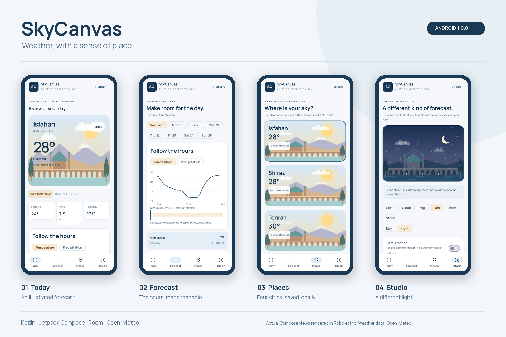
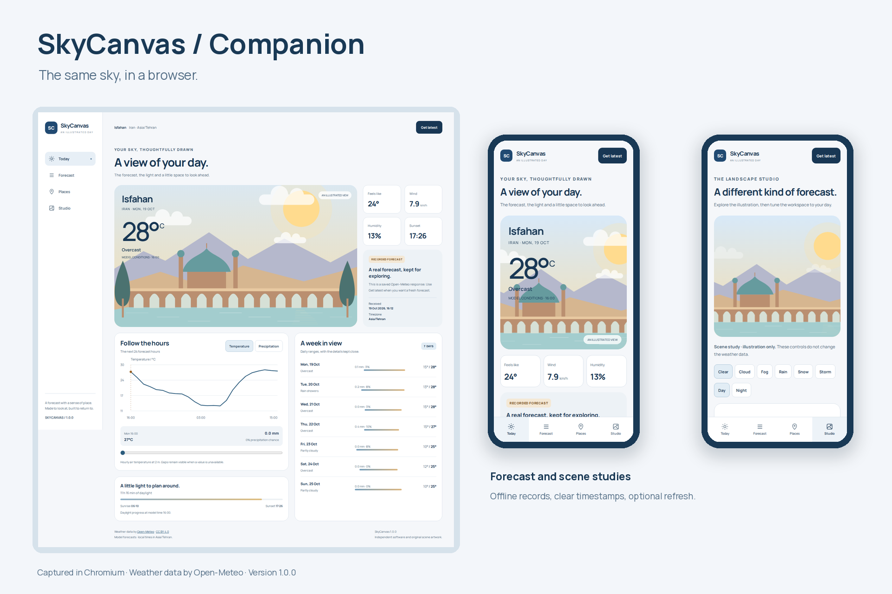

# SkyCanvas Android

**A little closer to the sky.**

SkyCanvas pairs a useful weather forecast with a landscape inspired by Isfahan: a bridge over water, distant mountains and a quiet dome. The scene follows the forecast's weather code and day or night flag. Temperature, rainfall and the time of the last successful download stay close at hand.

## A little movement

Sunlight breathes gently, clouds drift across clear skies and highlights move on the water. At night, stars brighten and fade at different speeds. Studio's Day and Night controls blend the sky and landscape over 1.6 seconds without changing the forecast. Turning off **Gentle motion** also makes those changes immediate. A [short recording of the browser companion](docs/day-night-motion.mp4) shows the controls in use.

## Take a look

The [interactive demo](demo/SkyCanvas.html) opens as a single local HTML file. Its forecasts, artwork and font are included, so you can explore without a connection. **Get latest** requests a fresh forecast when the API is reachable. The browser companion shares the visual language and data rules of the Kotlin app; it is a separate implementation.

The Android app is built with Kotlin and Jetpack Compose. Version **1.0.0** supports Android 8.0 and above, targets API 36 and includes four places: Isfahan, Shiraz, Tehran and Tabriz.

## What you can explore

- **Today:** illustrated conditions, feels-like temperature, wind, humidity and a seven-day outlook.
- **Forecast:** temperature and precipitation charts, hour selection, daily ranges, sunrise and sunset. Rainfall in millimetres and precipitation chance in percent have separate meanings and labels.
- **Places:** a saved forecast for each city, with switching that cancels the previous request.
- **Studio:** six scene studies in daylight or at night, temperature units, reduced motion and local frame measurements. Scene studies change the artwork independently of forecast data.

Forecasts are real public Open-Meteo responses. Bundled records carry their original retrieval times and a **Recorded forecast** label. They are model forecasts, not station observations. Refreshing validates a response before saving it; a failed request leaves the previous forecast and its timestamp intact.

## Under the surface

| Part | Responsibility |
| --- | --- |
| `app` | Compose screens, lifecycle-aware motion, ViewModel state and Android window frame measurements |
| `core:weather` | Kotlin models, strict forecast decoding, local time conversion and bounded timing summaries |
| `core:data` | OkHttp requests, Room persistence, DataStore preferences and refresh coordination |
| `demo` | Offline browser companion with IndexedDB, keyboard controls and a separate browser timing report |

The dependency graph is assembled explicitly. Coroutines keep network and database work away from the main thread. Per-city locks protect cache updates, request cancellation stops obsolete work, and a generation token keeps a late response from changing the selected city.

The stack is pinned: Kotlin 2.3.21, Compose BOM 2026.03.01, Room 2.8.4, DataStore 1.2.1, Coroutines 1.10.2, OkHttp 4.12.0, AGP 8.13.2 and Gradle 8.13. The Gradle wrapper includes its distribution checksum. The [architecture notes](docs/architecture.md) explain the choices and failure cases.

## What has been checked

The recorded verification covers **41 Kotlin tests**, **17 JavaScript tests** and **35 browser checks**, with six further motion checks. These include 16 automated accessibility scans across four screen widths. The Kotlin journeys open the actual Compose activity with Robolectric and exercise navigation, persistence, refresh failures and scene controls. Four additional Kotlin renderer tests compare the production drawing layers at controlled phases and daylight levels. Both debug and optimized preview APKs are built. Reports and their scope are in [verification](docs/verification.md).

The app measures Android window frames on a running device and can export its report. Physical-device smoothness, battery use and manual TalkBack testing are still to be measured. Browser timing results describe the tested browser only. See [performance](docs/performance.md).

## Data and confidentiality

Weather data is supplied by [Open-Meteo](https://open-meteo.com/) under [CC BY 4.0](https://creativecommons.org/licenses/by/4.0/). Source URLs, receive times and SHA-256 hashes are retained in [data/provenance.json](data/provenance.json). The public API's non-commercial service terms are separate from the data licence; commercial use requires an appropriate service arrangement. Details are in [data sources](docs/data-sources.md).

SkyCanvas is an independent implementation. It contains no employer source code, private endpoints, credentials, customer records or internal design assets. The illustrations were created for this project, and the weather records come from the public source above. See [confidentiality](docs/confidentiality.md) for the project boundary.

Code and original artwork: [MIT](LICENSE). The bundled Manrope font retains its [SIL Open Font License](docs/licenses/Manrope-OFL.txt). Third-party notices are collected in [NOTICE](NOTICE).
