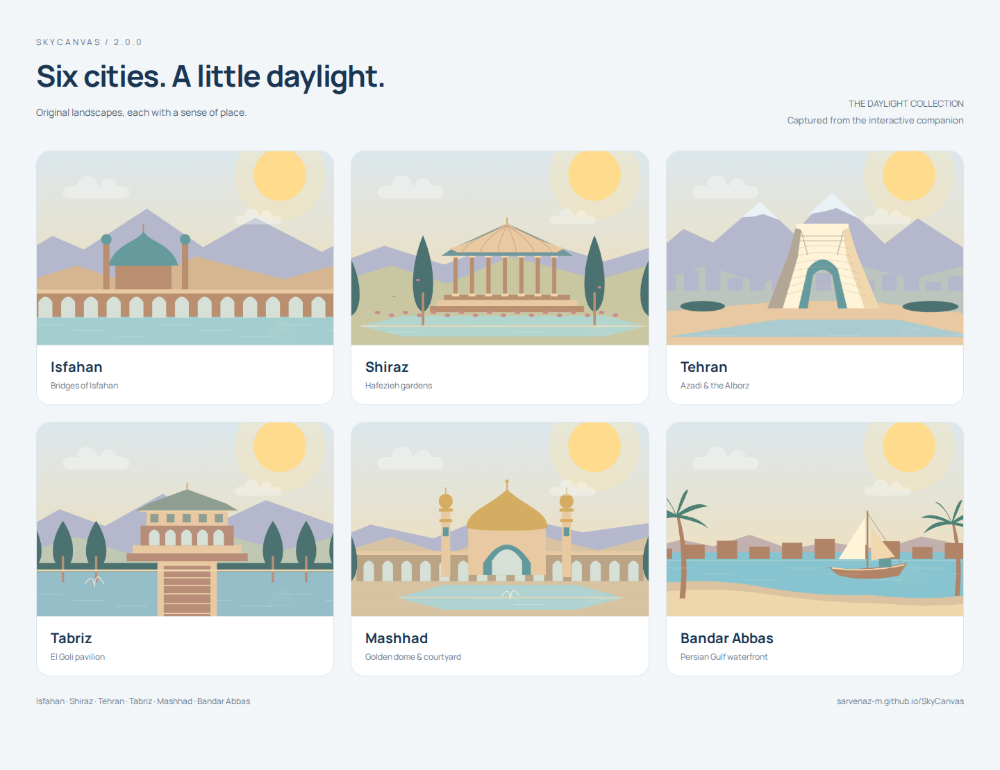
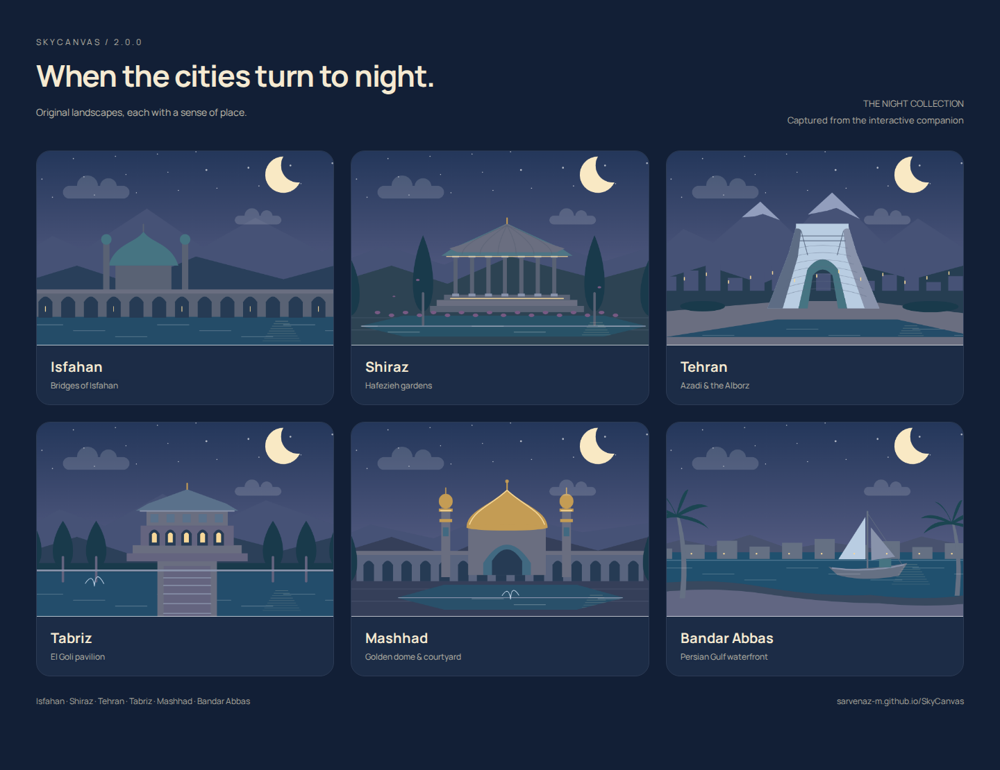
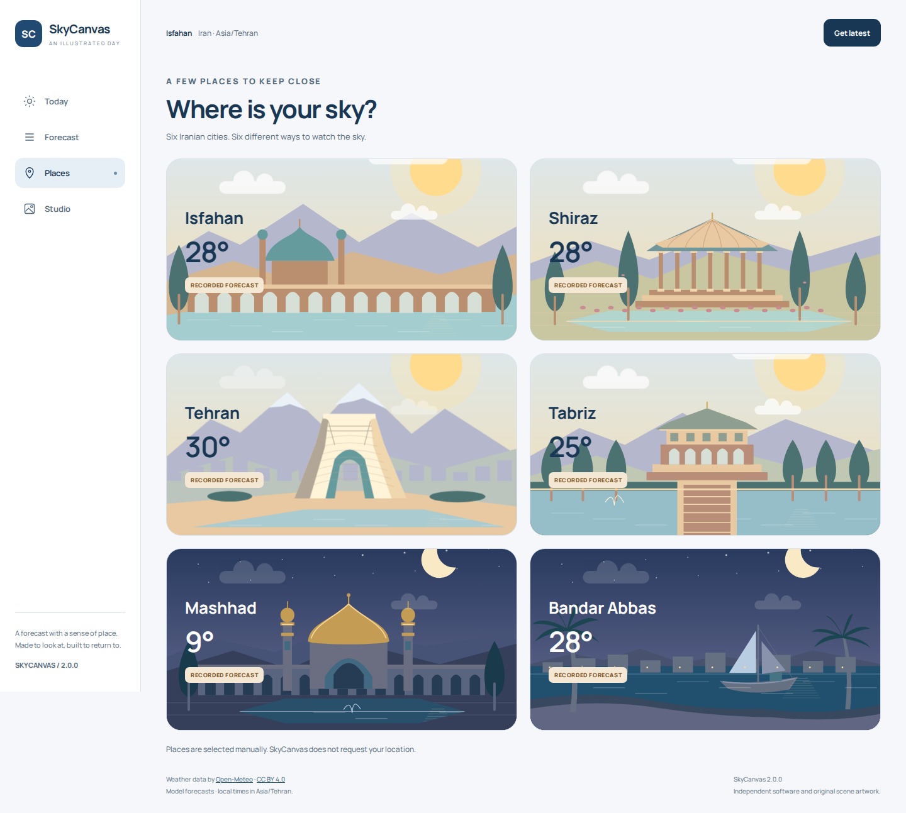
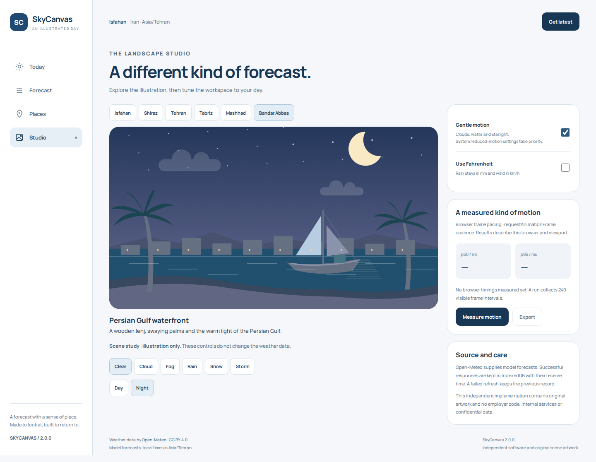
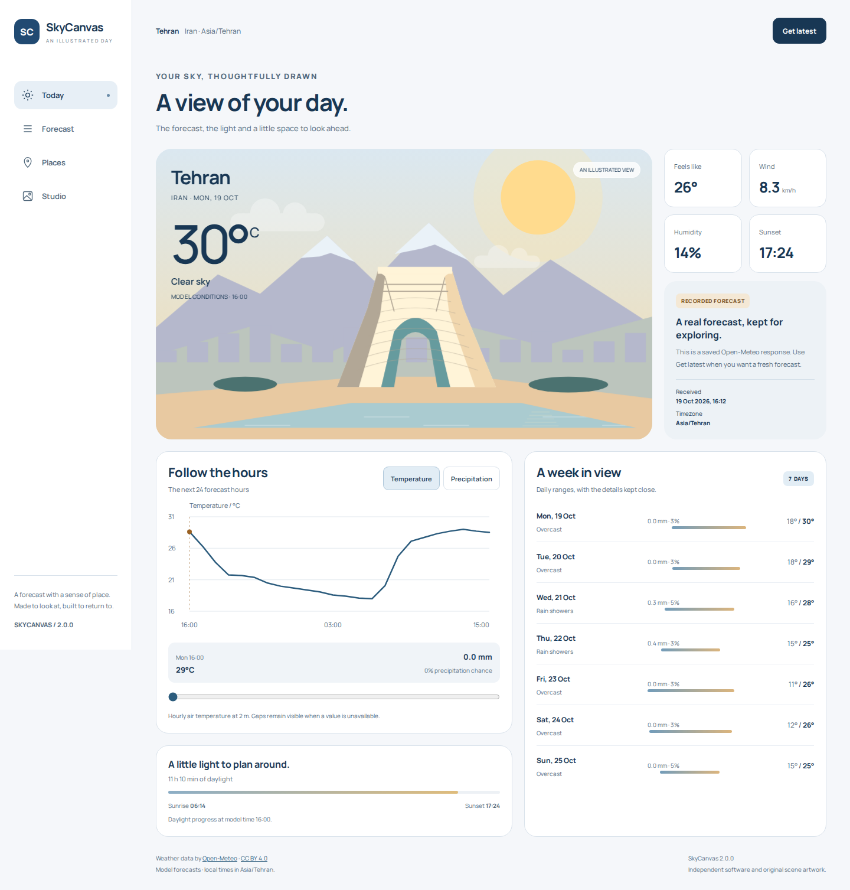
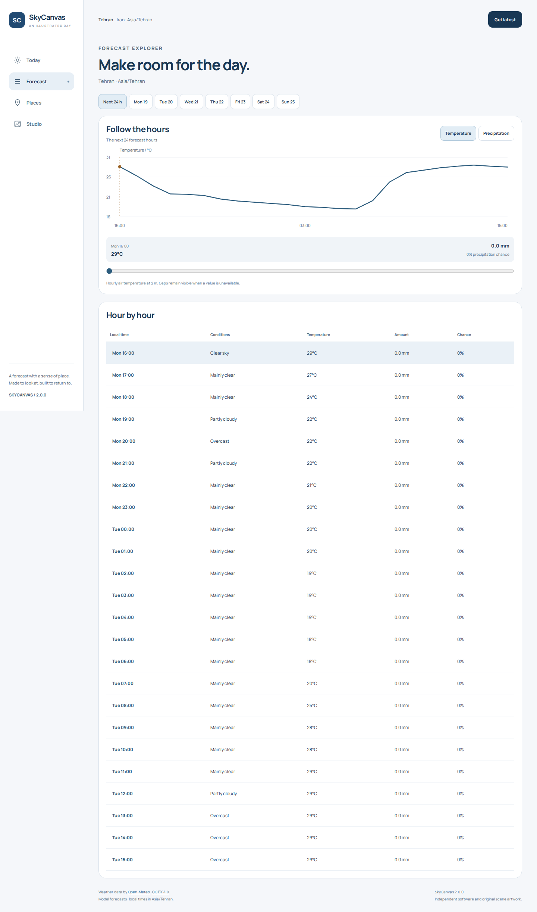
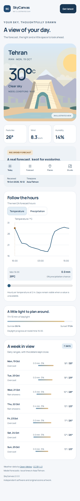
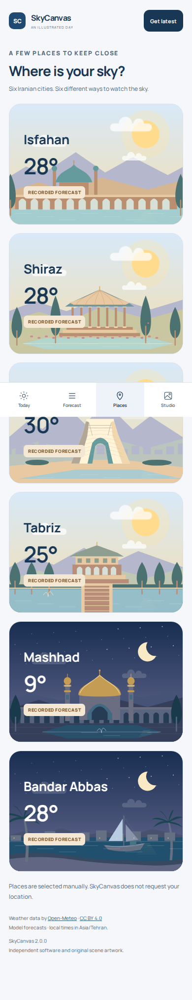
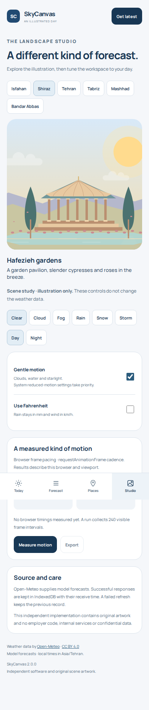

# SkyCanvas — version 2 gallery

All scenes below were captured from the rebuilt interactive companion. The gallery boards arrange unchanged crops from the production renderer. They show illustrations, not photographs or live cameras.

[Open the live demo](https://sarvenaz-m.github.io/SkyCanvas/) · [Project overview](../../README.md)

## Daylight collection

## Night collection

## In motion

## Native Android

## The companion

<table>
<tr><td width="50%"></td><td width="50%"></td></tr>
</table>

## On a smaller screen

<table>
<tr><td width="33%"></td><td width="33%"></td><td width="33%"></td></tr>
</table>

## Individual scenes

| City | Day | Night |
| --- | --- | --- |
| Isfahan | [Bridge and dome](city-isfahan-day.png) | [Lit arches](city-isfahan-night.png) |
| Shiraz | [Hafezieh gardens](city-shiraz-day.png) | [Pavilion lighting](city-shiraz-night.png) |
| Tehran | [Azadi and the Alborz](city-tehran-day.png) | [City lights](city-tehran-night.png) |
| Tabriz | [El Goli pavilion](city-tabriz-day.png) | [Lake reflections](city-tabriz-night.png) |
| Mashhad | [Golden dome](city-mashhad-day.png) | [Courtyard lighting](city-mashhad-night.png) |
| Bandar Abbas | [Persian Gulf waterfront](city-bandar-abbas-day.png) | [Moonlit lenj](city-bandar-abbas-night.png) |

Reproduce these views with `npm run build:demo` followed by `npm run capture:gallery`. Motion capture uses `npm run capture:motion`. Showcase boards use `npm run capture:showcases` after the native test captures have been copied into this directory.
